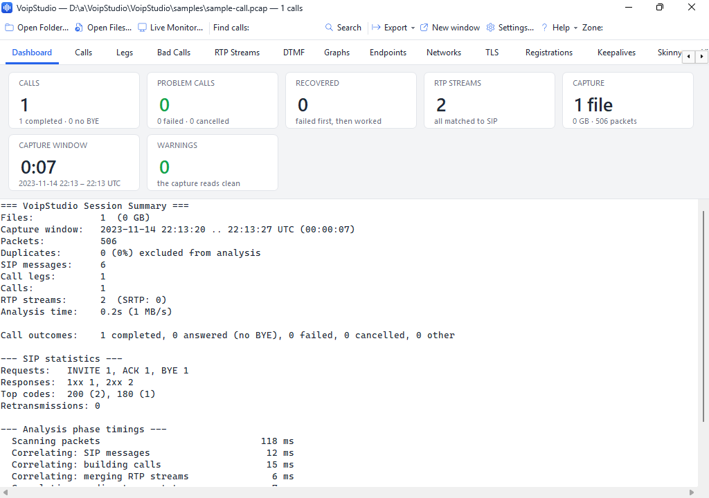

# VoipStudio

**Project credit:** My coworker [Bastian74](https://github.com/Bastian74), whom I follow on GitHub, conceived and created this tool. I use it.

VoipStudio opens packet captures of phone traffic (`.pcap`, `.pcapng` or `.cap` files, as saved by Wireshark or tcpdump) and turns them into calls you can read: who called whom, whether the call connected, how the audio sounded, and where something went wrong. It can play a call's audio, draw its call flow, estimate voice quality (MOS), and chart trends across thousands of calls.



It comes in two parts, both for Windows:

- **VoipStudio.exe**: the desktop program.
- **vsx.exe**: the same analysis from a command line.

This repository holds the ready-built program files and the [user manual](VoipStudio-Manual.html); the source code isn't published here.

## Windows: the desktop program

1. **Install the .NET 10 Desktop Runtime** (free, from Microsoft). In PowerShell:
   ```powershell
   winget install Microsoft.DotNet.DesktopRuntime.10
   ```
   Or download "Desktop Runtime", Windows x64, from [dotnet.microsoft.com/download/dotnet/10.0](https://dotnet.microsoft.com/download/dotnet/10.0).
2. **Download VoipStudio:** click the green **Code** button on this page, choose **Download ZIP**, then right-click the ZIP and choose **Extract All**. Keep all the files together in one folder.
3. **Double-click VoipStudio.exe.** If Windows shows **"Windows protected your PC"**, click **More info**, then **Run anyway**. The program isn't code-signed.
4. Click **Open Folder** on the toolbar and choose a folder of captures. VoipStudio opens on the Dashboard. Double-click any call to see its call flow, audio player and SIP messages. Press **F1** on any tab for help.

**To update:** close VoipStudio and extract the new ZIP over the old folder. Your settings and logs are kept separately (in `%APPDATA%\VoipStudio`).

## macOS and Linux

VoipStudio runs on Windows only. On a Mac or Linux computer, run it in a Windows virtual machine (for example Parallels on a Mac, or VirtualBox) and copy your captures there. The command-line tool starts on macOS and Linux with .NET 10, but analyzing a capture fails there, because it uses functions only Windows has.

## Try it with the sample call

The file [`samples/sample-call.pcap`](samples/sample-call.pcap) is one short made-up call (invented numbers and addresses, silent audio). Open it with **Open Files…** to see the dashboard above, then double-click the call on the **Calls** tab to see its call flow.

## Command-line examples

Open PowerShell or Command Prompt in the VoipStudio folder and type `vsx.exe` followed by a command:

```sh
vsx analyze <captures>                                 # summary of every call
vsx analyze <captures> --calls-csv calls.csv           # one row per call, for a spreadsheet
vsx analyze <captures> --endpoints-csv endpoints.csv   # which phones or addresses had bad calls
vsx call <call-id> <captures>                          # one call's legs, audio streams and timeline
vsx report <call-id> <captures> --out report.txt       # a plain-text problem report for one call
vsx export <call-id> <captures>                        # one call's audio (WAV), SIP log and packets
vsx --help                                             # every option
```

`<captures>` is a capture file or a folder of them.

## Playing iLBC, G.723.1 and AMR audio

Those three audio formats need the free **ffmpeg** program; everything else plays without it. Install it with `winget install Gyan.FFmpeg`, or put it in a folder named `ffmpeg` next to VoipStudio.exe.

## Manual

[VoipStudio-Manual.html](VoipStudio-Manual.html) has every page of the program's built-in help in one file. Download it and open it in any browser; it works offline. It explains each tab, every setting, and concepts like packet loss and MOS.

## Troubleshooting

| What you see | What to do |
| --- | --- |
| "You must install or update .NET to run this application" | Install the .NET 10 Desktop Runtime (step 1), x64 version. |
| Windows won't open it | See step 3. Some company PCs block unsigned programs; ask IT. |
| Some calls play no audio | That codec may need ffmpeg (see above). |

## Privacy

Packet captures can hold phone numbers, network addresses and the audio of calls. Only analyze captures you're allowed to use, and remove or replace that information before sharing a capture.

## License

There is no published license for redistributing these files. Ask the author before reusing them. Programs you install separately, such as .NET and ffmpeg, have their own terms.
